<!-- ╔══════════════════════════════════════════════════════════════╗
     ║  Alexander Coral · p4codev · Solutions Architect | AI & Data  ║
     ╚══════════════════════════════════════════════════════════════╝ -->

<div align="center">
  
</div>

<div align="center">
  <a href="https://github.com/p4codev">
    
  </a>
</div>

<br/>

<div align="center">
  <a href="https://p4codev.github.io"></a>
  <a href="https://linkedin.com/in/pacodev"></a>
  <a href="https://dev.to/pacodev"></a>
  <a href="https://x.com/pacodev"></a>
  
</div>

<br/>

## 👨‍💻 `whoami`

```python
class AlexanderCoral:
    def __init__(self):
        self.handle   = "p4codev"
        self.location = "Quito, Ecuador 🇪🇨"
        self.roles    = ["Solutions Architect", "AI Engineer", "Data Engineer"]
        self.clouds   = {"AWS": "☁️", "GCP": "☁️", "Azure": "☁️"}   # cloud-agnostic by design
        self.mindset  = "Technology enthusiast · Life-long learner"

    def what_i_do(self) -> list[str]:
        return [
            "Design multi-cloud architectures that are secure, cost-aware and built to scale",
            "Build data platforms: ingestion → lakehouse → warehouse → analytics",
            "Ship AI solutions: LLM apps, RAG, agents and MLOps pipelines",
            "Automate everything with IaC, CI/CD and event-driven patterns",
        ]

    def current_focus(self) -> str:
        return "GenAI on the cloud + modern data stack (BigQuery · Databricks · Snowflake)"
```

<br/>

## ☁️ Multi-Cloud Arsenal

<div align="center">
  
</div>

<br/>

<table align="center">
  <tr>
    <th align="center" width="33%">🟠 &nbsp;AWS</th>
    <th align="center" width="33%">🔵 &nbsp;Google Cloud</th>
    <th align="center" width="33%">🟦 &nbsp;Azure</th>
  </tr>
  <tr>
    <td align="center" valign="top">
      <br/>
      <br/>
      <br/>
      <br/>
      <br/>
      
    </td>
    <td align="center" valign="top">
      <br/>
      
      <br/>
      
      <br/>
      
      <br/>
      <br/>
      
    </td>
    <td align="center" valign="top">
      <br/>
      <br/>
      <br/>
      <br/>
      <br/>
      
    </td>
  </tr>
</table>

<br/>

## 🏗️ How I think about architecture

> One reference blueprint, portable across the three clouds. Swap the boxes, keep the pattern.

```mermaid
flowchart LR
    subgraph SRC["📥 Sources"]
        A1[(Databases)]
        A2[APIs / SaaS]
        A3[Events / IoT]
    end

    subgraph ING["⚡ Ingestion & Streaming"]
        B1["Kafka · Kinesis\nPub/Sub · Event Hubs"]
    end

    subgraph LAKE["🪣 Lakehouse"]
        C1["S3 · GCS · ADLS"]
        C2["Spark · Databricks\nDataflow · Glue"]
    end

    subgraph DWH["🏛️ Warehouse & Serving"]
        D1["BigQuery · Redshift\nSynapse · Snowflake"]
        D2["dbt · Airflow · Composer"]
    end

    subgraph AI["🧠 AI Layer"]
        E1["Vertex AI · Bedrock\nAzure OpenAI"]
        E2["RAG · Agents · MLOps"]
    end

    subgraph OUT["📊 Consumers"]
        F1[Dashboards]
        F2[APIs & Apps]
        F3[LLM Assistants]
    end

    SRC --> ING --> LAKE --> DWH --> OUT
    LAKE --> AI --> OUT
    DWH --> AI

    classDef cloud fill:#0F172A,stroke:#38BDF8,color:#fff,stroke-width:1px;
    class B1,C1,C2,D1,D2,E1,E2 cloud;
```



<br/>

## 🧰 Tech Stack

<details open>
<summary><b>🗄️ &nbsp;Data Engineering</b></summary>
<br/>
<div align="center">
  
  
  
  
  
  <br/>
  
  
  
  
  
  <br/>
  
  
  
  
  
  
</div>
</details>

<details open>
<summary><b>🤖 &nbsp;AI · ML · GenAI</b></summary>
<br/>
<div align="center">
  
  <br/><br/>
  
  
  
  
  <br/>
  
  
  
  
  
  
  
</div>
</details>

<details open>
<summary><b>⚙️ &nbsp;DevOps · IaC · Platform</b></summary>
<br/>
<div align="center">
  
</div>
</details>

<details open>
<summary><b>💻 &nbsp;Languages · Backend · Databases</b></summary>
<br/>
<div align="center">
  
  <br/><br/>
  
</div>
</details>

<details>
<summary><b>🎨 &nbsp;Frontend & Tooling</b></summary>
<br/>
<div align="center">
  
</div>
</details>

<br/>

## 📊 GitHub Pulse

<div align="center">
  
  
</div>

<div align="center">
  
</div>

<br/>

## 🧭 Currently

| 🚀 Building | 📚 Learning | ✍️ Writing | 🤝 Open to |
|:--|:--|:--|:--|
| Multi-cloud data platforms & LLM-powered assistants | Agentic AI patterns, Lakehouse (Iceberg / Delta), FinOps | Cloud & data notes on [dev.to/pacodev](https://dev.to/pacodev) | Architecture reviews, collabs and interesting problems |

<br/>

## 📫 Let's connect

<div align="center">
  <a href="https://linkedin.com/in/pacodev"></a>
  <a href="https://x.com/pacodev"></a>
  <a href="https://dev.to/pacodev"></a>
  <a href="https://p4codev.github.io"></a>
</div>

<br/>

<div align="center">
  <i>"Architecture is not about the cloud you pick — it's about the trade-offs you understand."</i>
</div>

<div align="center">
  
</div>
